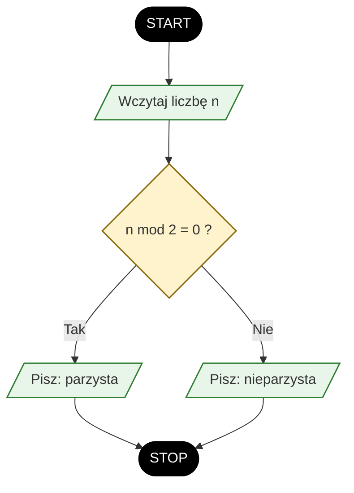
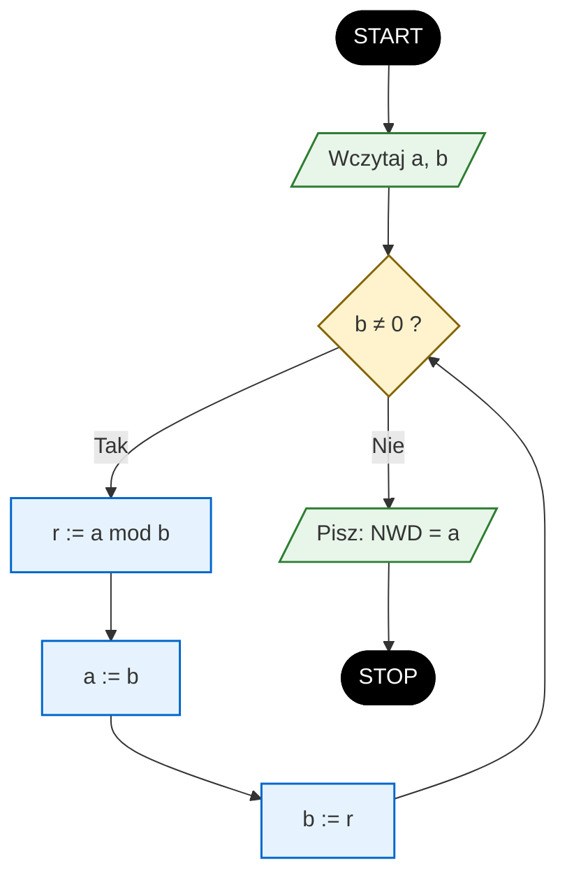
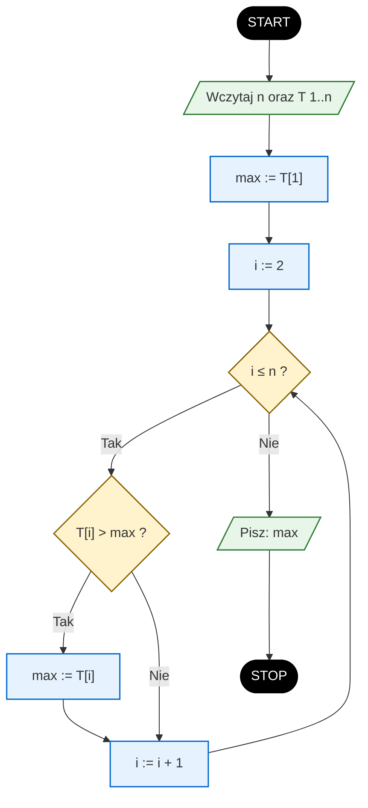
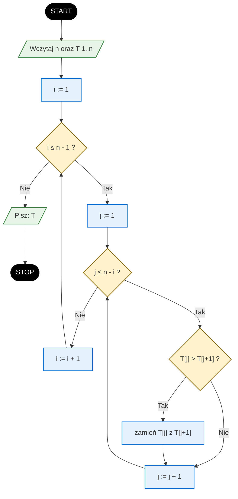

# Algorytmy

## Przydatne linki
- https://www.aragorn.wi.pb.edu.pl/~teodora/PP/C/SB.pdf
- https://zpe.gov.pl/a/przeczytaj/DrYJY1MWa
- https://zelota.hosting24.pl/pdf/Informatyka/Algorytmy/001_schematy%20blokowe.pdf
- https://asana.com/pl/resources/what-is-a-flowchart
- https://www.atlassian.com/pl/software/confluence/resources/guides/how-to/algorithm-chart
- https://en.wikipedia.org/wiki/Flowchart
### Dokumentacja i norma
- https://mermaid.js.org/syntax/flowchart.html
- https://www.vde-verlag.de/iec-normen/245963/iso-5807-1985.html - norma ISO 5807:1985 (symbole schematów blokowych)
### Narzędzia
- Mermaid: https://mermaid.live/
- draw.io / diagrams.net: https://app.diagrams.net/
- PlantUML: https://www.plantuml.com/plantuml/uml/


## Co to jest algorytm?
**Algorytm** to skończony, uporządkowany ciąg jednoznacznych czynności prowadzący do rozwiązania określonego zadania. Dla poprawnych danych wejściowych, po wykonaniu skończonej liczby kroków, zwraca poprawny wynik.

Algorytm można zapisać na kilka sposobów:

| Sposób zapisu                     | Charakter                                          |
| --------------------------------- | -------------------------------------------------- |
| **Opis słowny**                   | mało ścisły, zrozumiały dla każdego                |
| **Lista kroków**                  | dokładniejsza niż opis słowny                      |
| **Pseudokod**                     | zbliżony do języka programowania                   |
| **Schemat blokowy**               | graficzny, pokazuje przepływ sterowania            |
| **Schemat Nassiego-Shneidermana** | graficzny, zwarty, bez strzałek                    |


## Schemat blokowy (flowchart)
**Schemat blokowy** to graficzny zapis algorytmu. Składa się z bloków (figur geometrycznych) połączonych strzałkami, które wyznaczają kolejność wykonywania operacji. W blokach umieszcza się proste instrukcje i warunki.

### Cel
* **Pokazanie kolejności kroków** i punktów decyzyjnych algorytmu.
* **Wykrycie błędów logicznych** na etapie projektu, zanim algorytm zostanie zapisany w kodzie.
* **Zapis niezależny od języka programowania** – na jego podstawie algorytm można zaimplementować w dowolnym języku.
* **Wspólny język** dla programistów, analityków i osób nietechnicznych.

### Wykorzystanie
* **Projektowanie algorytmów** przed implementacją.
* **Dokumentacja** logiki programu i procesów biznesowych (np. obieg dokumentów, obsługa zgłoszeń).
* **Nauka programowania** – instrukcje warunkowe, pętle, tablice.
* **Przegląd kodu** i szukanie błędów lub wąskich gardeł w logice.

> Dla dużych systemów schemat blokowy szybko staje się nieczytelny. Wtedy lepiej sprawdzają się diagramy UML, w szczególności **diagram aktywności** (zob. [03 UML](../03%20UML/Readme.md)).

### Elementy schematu blokowego

| Blok                           | Kształt                         | Znaczenie                                              |
| ------------------------------ | ------------------------------- | ------------------------------------------------------ |
| **Graniczny (START / STOP)**   | elipsa                          | początek i koniec algorytmu                            |
| **Wejścia-wyjścia**            | równoległobok                   | wczytanie danych, wypisanie wyników                    |
| **Operacyjny**                 | prostokąt                       | przypisanie, obliczenie, zmiana wartości               |
| **Decyzyjny (warunkowy)**      | romb                            | sprawdzenie warunku i wybór jednej z dwóch dróg        |
| **Wywołania podprogramu**      | prostokąt z podwójnymi bokami   | wywołanie funkcji lub procedury opisanej osobno        |
| **Łącznik**                    | małe koło                       | przeniesienie schematu w inne miejsce lub na inną stronę |
| **Komentarz**                  | otwarty nawias przy bloku       | dodatkowe objaśnienie, nie wpływa na przebieg          |
| **Strzałka**                   | linia ze strzałką               | kierunek i kolejność wykonywania                       |

#### Zasady rysowania
1. **START** – jeden na schemat; nie wchodzi do niego żadna strzałka, wychodzi jedna.
2. **STOP** – wchodzi do niego strzałka, nie wychodzi żadna. Dla czytelności można narysować kilka bloków STOP.
3. **Blok decyzyjny** ma zawsze dwa wyjścia opisane `TAK` / `NIE`.
4. **Blok operacyjny** ma jedno wejście i jedno wyjście.
5. Schemat czytamy zasadniczo **z góry na dół** i **z lewej do prawej**.
6. Unikamy przecinania się linii (w razie potrzeby stosujemy łączniki).
7. Zapis krótki i jednoznaczny, jedna konwencja przypisania w całym schemacie (np. `:=`).

#### Podstawowe struktury sterowania
* **Sekwencja**: kroki wykonywane jeden po drugim.
* **Selekcja** (`if … else`): romb z dwoma wyjściami.
* **Iteracja** (`while`, `for`): romb, z którego jedna ze ścieżek wraca strzałką do wcześniejszego bloku.


## Przykłady algorytmów

### Parzystość liczby
**Cel:** sprawdzić, czy wczytana liczba całkowita jest parzysta.



Pseudokod:
```
czytaj n
jeżeli n mod 2 = 0 to
    pisz "parzysta"
w przeciwnym razie
    pisz "nieparzysta"
```

### Największy wspólny dzielnik (algorytm Euklidesa)
**Cel:** wyznaczyć NWD dwóch liczb naturalnych `a` i `b`.

**Idea:** dopóki `b ≠ 0`, zastępujemy parę `(a, b)` parą `(b, a mod b)`. Gdy `b = 0`, wynikiem jest `a`.



Pseudokod:
```
czytaj a, b
dopóki b ≠ 0 wykonuj
    r := a mod b
    a := b
    b := r
pisz a
```
**Test:** `a = 48`, `b = 18` → `(48, 18)` → `(18, 12)` → `(12, 6)` → `(6, 0)` → **NWD = 6**.

**Złożoność:** czasowa O(log min(a, b)), pamięciowa O(1).

### Wartość maksymalna w tablicy
**Cel:** znaleźć największy element n-elementowej tablicy `T`.



Pseudokod:
```
czytaj n, T[1..n]
max := T[1]
dla i := 2 do n wykonuj
    jeżeli T[i] > max to max := T[i]
pisz max
```
**Złożoność:** czasowa O(n), pamięciowa O(1).

### Sortowanie bąbelkowe (bubble sort)
**Cel:** uporządkować tablicę rosnąco przez porównywanie i zamianę sąsiednich elementów.



**Złożoność:** czasowa O(n²), pamięciowa O(1); sortowanie stabilne.


## Schemat blokowy a diagram aktywności UML

| Cecha                     | Schemat blokowy (flowchart)                              | Diagram aktywności (UML)                                         |
| :------------------------ | :------------------------------------------------------- | :--------------------------------------------------------------- |
| **Przeznaczenie**         | Zapis algorytmu, logiki programu.                        | Modelowanie procesów, scenariuszy przypadków użycia.            |
| **Notacja**               | Prosta, niezależna od UML (ISO 5807).                    | Część standardu UML.                                             |
| **Współbieżność**         | Nie przewiduje równoległych ścieżek.                     | Pozwala przedstawić działania równoległe (rozwidlenie, złączenie). |
| **Odpowiedzialność**      | Brak podziału na role.                                   | Możliwy podział na partycje (kto wykonuje daną czynność).        |
| **Przykładowe pytanie**   | **„Jak działa ten algorytm krok po kroku?”**             | **„Jak przebiega proces i kto go wykonuje?”**                    |


